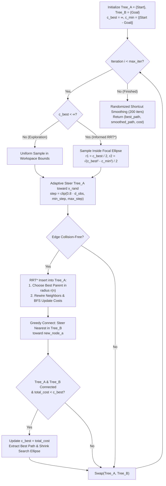

# PathPlaning_RRT — Hybrid Bidirectional Informed Adaptive RRT* in 2D & 3D


A Python implementation and interactive 2D/3D visualization suite for **Sampling-Based Robot Motion Planning**, developed as the **Final Project** for a university **Robotics** course. This repository introduces **`RRTPlus`**, a unified path-planning algorithm that combines the rapid exploration of **Bidirectional RRT-Connect**, the asymptotic optimality of **RRT\*** (best-parent selection & dynamic tree rewiring), **Informed RRT\*** prolate ellipsoidal sampling, **Obstacle-Aware Adaptive Step Sizing**, and **Randomized Shortcut Path Smoothing**.

---

## Table of Contents

- [Overview](#overview)
- [Evolution of RRT: 5 Unified Enhancements](#evolution-of-rrt-5-unified-enhancements)
- [Algorithmic Pipeline & Mathematical Formulation](#algorithmic-pipeline--mathematical-formulation)
- [Interactive Visualization Modes](#interactive-visualization-modes)
- [Project Structure](#project-structure)
- [API Reference](#api-reference)
- [Installation & Usage](#installation--usage)
- [Presentation Slides](#presentation-slides)
- [Authors](#authors)

---

## Overview

Classical **Rapidly-exploring Random Trees (RRT)** are probabilistically complete and effective in high-dimensional configuration spaces, but suffer from three well-known limitations in practice:
1. **Suboptimal, Jagged Trajectories**: Classical RRT traps the first feasible path without optimizing path cost.
2. **Slow Convergence**: Uniformly sampling the entire state space wastes computation after an initial solution is already known.
3. **Narrow Passage Bottlenecks**: A fixed step size creates a trade-off between fast open-space traversal (large step) and safe maneuvering near obstacles (small step).

To overcome all three limitations simultaneously, [`RRTPlus`](rrt/rrt_plus.py) integrates five complementary heuristics from modern motion-planning literature into a single planner that operates seamlessly in both **2D planar** and **3D spatial** environments.

---

## Evolution of RRT: 5 Unified Enhancements

1. **RRT\* Asymptotic Optimality (Best Parent & Dynamic Rewiring)**
   - For every newly steered node $x_{\text{new}}$, the planner queries all existing tree nodes within a dynamically shrinking ball radius:
     $$r(n) = \min\left(r_{\text{search}} \sqrt{\frac{\ln n}{n}}, \; 3 \cdot s_{\max}\right)$$
   - **Best Parent Selection**: Connects $x_{\text{new}}$ to the collision-free neighbor $x_{\text{near}}$ that minimizes cumulative cost-to-come $c(x_{\text{near}}) + \|x_{\text{new}} - x_{\text{near}}\|_2$.
   - **Tree Rewiring & Cost Propagation**: Checks whether routing any neighbor $x_{\text{near}}$ *through* $x_{\text{new}}$ reduces $c(x_{\text{near}})$. When an improvement is found, $x_{\text{near}}$ is re-parented to $x_{\text{new}}$ and the cost reduction is propagated to all descendants via Breadth-First Search (`update_costs`).

2. **Informed RRT\* (Focused Ellipsoidal Sampling)**
   - Once an initial valid path of cost $c_{\text{best}}$ is found between $\mathbf{x}_{\text{start}}$ and $\mathbf{x}_{\text{goal}}$ (where $c_{\min} = \|\mathbf{x}_{\text{goal}} - \mathbf{x}_{\text{start}}\|_2$), no state outside the prolate hyperspheroid (ellipse in 2D) with focal points at Start and Goal and transverse diameter $c_{\text{best}}$ can possibly improve the solution.
   - `sample_ellipse` restricts all subsequent random samples to the interior of this ellipse, which shrinks in real time as shorter paths are discovered.

3. **Bidirectional RRT-Connect (`Tree_A` & `Tree_B`)**
   - Simultaneously grows two RRT\* trees—`tree_a` rooted at **Start** and `tree_b` rooted at **Goal**—swapping their roles after every iteration.
   - Whenever `tree_a` adds a new vertex `new_node_a`, `tree_b` greedily steers its nearest vertex directly toward `new_node_a`. If the two trees approach within `min_step` along a collision-free segment, the complete path is extracted (`extract_path`) and `c_best` is updated.

4. **Obstacle-Aware Adaptive Step Size (`get_adaptive_step`)**
   - Dynamically scales the extension distance during `steer()` based on Euclidean clearance $d_{\text{obs}}$ to the nearest obstacle:
     $$s(\mathbf{x}) = \text{clip}\left(0.8 \cdot d_{\text{obs}}(\mathbf{x}), \; s_{\min}, \; s_{\max}\right)$$
   - In open regions, the tree expands rapidly with steps up to $s_{\max}$ (`3.0` in 2D, `4.0` in 3D); near obstacles and inside narrow corridors, it automatically throttles down to $s_{\min}$ (`0.2`) for fine-grained collision avoidance.

5. **Randomized Shortcut Path Smoothing (`smooth_path`)**
   - Post-processes the optimal RRT\* piecewise-linear trajectory over 200 iterations by sampling random non-adjacent waypoint pairs $(i, j)$ and replacing the intermediate sub-path with a direct segment $\overline{\mathbf{p}_i \mathbf{p}_j}$ whenever `is_collision_free` succeeds.

---

## Algorithmic Pipeline & Mathematical Formulation



### Key Geometric Formulas ([`rrt/utils.py`](rrt/utils.py))

- **Point-to-Segment Distance (Freehand Obstacle Collision Check)**:
  For a drawn obstacle point $\mathbf{p}$ and trajectory segment $\overline{\mathbf{a}\mathbf{b}}$, the projection parameter $t \in [0, 1]$ is:
  $$t = \max\left(0, \min\left(1, \frac{(\mathbf{p} - \mathbf{a}) \cdot (\mathbf{b} - \mathbf{a})}{\|\mathbf{b} - \mathbf{a}\|_2^2}\right)\right), \quad d(\mathbf{p}, \overline{\mathbf{a}\mathbf{b}}) = \|\mathbf{p} - (\mathbf{a} + t(\mathbf{b} - \mathbf{a}))\|_2$$
  A segment is collision-free if $d(\mathbf{p}, \overline{\mathbf{a}\mathbf{b}}) \ge \text{clearance}$ for all obstacle points $\mathbf{p}$.

- **Informed Ellipse Sampling (`sample_ellipse`)**:
  Given Uniform polar sample $\rho = \sqrt{u_1}, \; \phi \sim \mathcal{U}(0, 2\pi)$ inside the unit disk, the rotated point in the world frame is:
  $$\begin{bmatrix} x \\ y \end{bmatrix} = \frac{\mathbf{x}_{\text{start}} + \mathbf{x}_{\text{goal}}}{2} + \begin{bmatrix} \cos\theta & -\sin\theta \\ \sin\theta & \cos\theta \end{bmatrix} \begin{bmatrix} r_1 \rho \cos\phi \\ r_2 \rho \sin\phi \end{bmatrix}, \quad \theta = \text{atan2}(y_g - y_s, x_g - x_s)$$

---

## Interactive Visualization Modes

Running `python main.py` launches an interactive CLI menu offering **4 visualization modes**:

| Mode | Function in `main.py` | Description |
| :---: | :--- | :--- |
| **1** | `run_static_2d()` | **Static 2D Benchmark**: Plans from `[2, 2]` to `[18, 18]` across 5 circular obstacles. Animates `Tree_A` (blue), `Tree_B` (orange), tree bridges (magenta), the shrinking Informed RRT\* ellipse (purple dashed), the raw RRT\* path (green dashed), and the final smoothed trajectory (gold). |
| **2** | `run_static_3d()` | **Fast 3D Spatial Benchmark**: Plans from `[2, 2, 2]` to `[18, 18, 18]` around 3D spherical obstacles. Uses `np.nan`-delimited coordinate batch arrays (`set_data_3d`) refreshed every 25 iterations to maintain high frame rates in Matplotlib 3D. |
| **3** | `run_interactive_2d()` | **Click-to-Plan 2D**: Prompts the user to left-click any **Start** point (blue `X`) and **Goal** point (red `X`) on the obstacle map via `plt.ginput(2)` and immediately executes `RRTPlus`. |
| **4** | `run_custom_draw_2d()` | **Freehand Maze & Obstacle Drawer**: Provides an interactive canvas (`ObstacleDrawer`) where you can hold Left-Click to paint custom walls, corridors, or traps of any shape, then click the **`RUN ULTIMATE RRT`** button to watch the planner solve your custom environment with safety `clearance = 0.8`. |

---

## Project Structure

```text
PathPlaning_RRT/
├── main.py                     # Interactive CLI launcher & 2D/3D Matplotlib visualization modes
├── requirements.txt            # Python package dependencies (numpy, matplotlib)
├── README.md                   # Project documentation
│
├── rrt/                        # Core RRTPlus motion planning package
│   ├── __init__.py             # Package initializer
│   ├── node.py                 # Node class (coords, parent pointer, cumulative cost)
│   ├── rrt_plus.py             # RRTPlus planner (Bi-RRT-Connect, RRT*, Informed, Adaptive, Smoothing)
│   └── utils.py                # Euclidean distance, collision detection & informed ellipse sampler
│
└── Slides/
    └── RRT.pdf                 # Course presentation deck ("Evolution of RRT")
```

---

## API Reference

### `RRTPlus` ([`rrt/rrt_plus.py`](rrt/rrt_plus.py))

```python
rrt = RRTPlus(
    start=[2, 2],
    goal=[18, 18],
    bounds=[[0, 20], [0, 20]],
    obstacles=[(6, 6, 3), (14, 14, 3), (10, 10, 2.5)],
    min_step=0.2,
    max_step=3.0,
    max_iter=800,
    search_radius=5.0,
    obs_type='geometric',  # 'geometric' (spheres/circles) or 'drawn' (point cloud)
    clearance=0.5
)
best_path, smoothed_path, smoothed_cost = rrt.plan(draw_callback=None)
```

| Method | Description |
| :--- | :--- |
| `get_random_node()` | Samples uniformly within `bounds` when `c_best == inf`, or inside the Informed RRT\* focal ellipse once a path exists. |
| `get_adaptive_step(coords)` | Computes `clip(0.8 * dist_obs, min_step, max_step)` from the nearest obstacle distance. |
| `steer(from_node, to_node)` | Advances from `from_node` toward `to_node` by at most the adaptive step size and initializes cumulative cost. |
| `get_near_nodes(tree, new_node)` | Finds all nodes in `tree` within the RRT\* shrinking radius $r = \min(r_{\text{search}}\sqrt{\ln n / n}, 3 s_{\max})$. |
| `insert_node(tree, nearest, new)` | Connects `new` to the minimum-cost collision-free parent in `near_nodes`, rewires neighbors, and updates subtree costs. |
| `update_costs(tree, start_node)` | Breadth-first cost propagation through descendants after an RRT\* rewiring event. |
| `extract_path(node_a, node_b)` | Reconstructs the full waypoint sequence from `start` to `goal` across both trees. |
| `smooth_path(path, iterations=200)` | Applies randomized line-of-sight shortcutting to eliminate redundant waypoints. |
| `plan(draw_callback=None)` | Runs the main bidirectional planning loop for `max_iter` iterations and returns `(best_path, smoothed_path, smoothed_cost)`. |

---

## Installation & Usage

### 1. Clone the Repository
```bash
git clone https://github.com/DavitBakh/PathPlaning_RRT.git
cd PathPlaning_RRT
```

### 2. Install Dependencies
Requires **Python 3.9+** with `numpy` and `matplotlib`:
```bash
pip install numpy matplotlib
```
*(Or via the requirements file: `pip install -r requirements.txt`)*

### 3. Run the Interactive Suite
```bash
python main.py
```

---

## Presentation Slides

The [`Slides/RRT.pdf`](Slides/RRT.pdf) deck (**"Эволюция RRT"**) accompanying this project presents the theoretical progression from baseline RRT through RRT\*, Informed RRT\*, Bidirectional RRT-Connect, Obstacle-Aware Adaptive Step Sizing, and Greedy Shortcut Smoothing with visual diagrams and equations.

---

## Authors

- **Davit Bakhshyan** — [@DavitBakh](https://github.com/DavitBakh)
- **Gegham Harutyunyan** — [@Gegham05](https://github.com/Gegham05)
